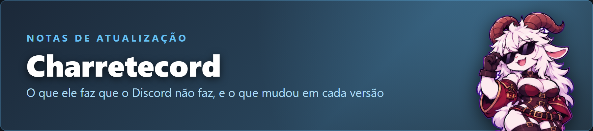
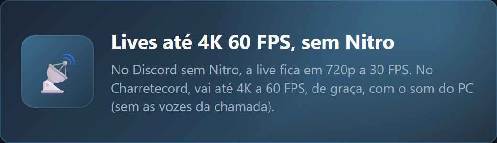
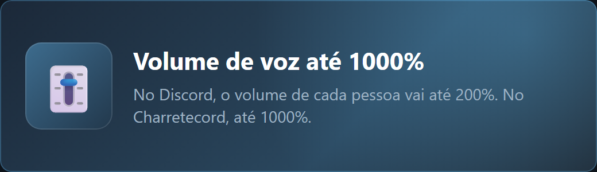
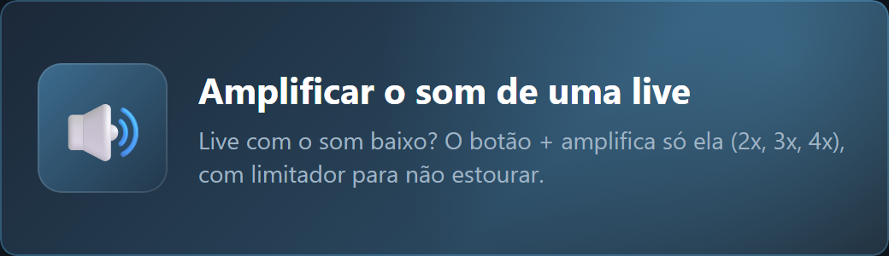
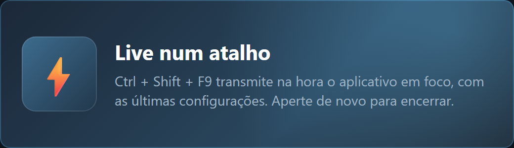
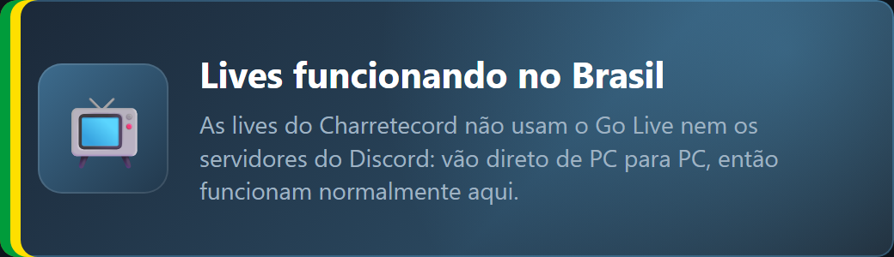
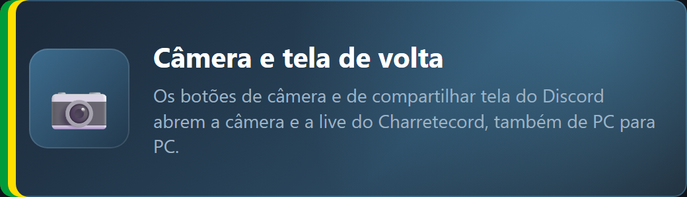

# Novidades do Charretecord

O que o Charretecord tem de diferente do Discord e o histórico de tudo o que mudou em cada versão. Dentro do app, a janela de novidades abre sozinha depois de cada atualização (e em Configurações → Plugins → CharreteLive → **Novidades do Charretecord**).

## A mais que o Discord

<table>
<tr>
<td></td>
<td></td>
</tr>
<tr>
<td></td>
<td></td>
</tr>
<tr>
<td></td>
<td></td>
</tr>
<tr>
<td></td>
</tr>
</table>

## No Brasil

Desde 12/08/2026, por ordem da ANPD, as transmissões ao vivo (Go Live) do Discord estão suspensas no Brasil, e o recurso do Discord foi negado em 19/11/2026. Segundo o próprio Discord, a medida também atinge chamadas de vídeo e o compartilhamento de tela. Texto e voz continuam funcionando.

Fontes: [Agência Brasil](https://agenciabrasil.ebc.com.br/radioagencia-nacional/geral/audio/2026-11/anpd-rejeita-recurso-do-discord-e-mantem-lives-suspensas-no-pais), [Olhar Digital](https://olhardigital.com.br/2026/11/19/internet-e-redes-sociais/anpd-nega-recurso-do-discord-e-mantem-lives-suspensas-no-brasil), [Carta Capital](https://www.cartacapital.com.br/toquetec/discord-suspende-recursos-de-video-no-brasil-apos-determinacao-da-anpd/).

<table>
<tr>
<td></td>
<td></td>
</tr>
</table>

## Notas de atualização

### v1.7.3 · Botão da soundboard

20/11/2026

- 🔵 **MELHORIA** A Charrete Soundboard ganhou um botão no painel de voz, ao lado do botão de soundboard do Discord. Ele abre a janela onde você envia, organiza e toca os seus sons.
- 🔵 **MELHORIA** A janela mostra os sons em quadros: um clique toca. Em "Editar sons", renomeie, reordene, apague e dê reforço a cada um.
- 🔵 **MELHORIA** O 🔉 saiu da linha Charrete Live.

### v1.7.2 · Novidades revistas

20/11/2026

- 🔵 **MELHORIA** A janela de novidades mostra só o que o Charretecord faz que o Discord não faz, e uma seção sobre o Brasil: com o Go Live suspenso pela ANPD, as lives e a câmera do Charretecord funcionam porque vão de PC para PC.
- 🟠 **CORREÇÃO** O volume de voz vai até 1000% (o texto dizia 500%).

### v1.7.1 · Soundboard

20/11/2026

- 🔵 **MELHORIA** Base atualizada para o Vesktop 1.7.0 (por isso o número pulou de 1.6 para 1.7).
- 🟢 **NOVO** Soundboard: sons de até 15 s, guardados só no seu PC, tocados como áudio ao vivo para quem está na chamada com o Charretecord. Um por vez, com 2 s de intervalo, reforço por som e atalhos "Charrete Soundboard: som 1 a 12".
- 🟢 **NOVO** Volume das soundboards separado do microfone, silenciar a soundboard de uma pessoa (botão direito nela) e opção para nunca ouvir soundboards.
- 🟢 **NOVO** Esta janela de novidades.
- 🔵 **MELHORIA** A tela de Atalhos do teclado avisa que, em jogos que rodam como administrador, talvez seja preciso abrir o Charretecord como administrador.

### v1.6.31 · Amplificar o som

19/11/2026

- 🟢 **NOVO** Botão + nas lives com som: amplifica só aquela live (2x, 3x, 4x), com limitador. Sem mexer, o volume continua o mesmo.

### v1.6.30 · A cabra de óculos

18/11/2026

- 🔵 **MELHORIA** O ícone de quem usa o Charretecord virou a cabra de óculos, à direita do nome e das tags e antes do AO VIVO.

### v1.6.29 · Quem usa o Charretecord

18/11/2026

- 🟢 **NOVO** Ícone ao lado do nome de quem usa o Charretecord, na lista de voz e na de membros, mesmo com senhas de sala diferentes. Nenhum IP é compartilhado.

### v1.6.28 · Codificação pela placa

18/11/2026

- 🔵 **MELHORIA** O H.264 da live usa os perfis High/Main, que vão para o codificador da placa de vídeo, em vez de cair no processador.
- 🔵 **MELHORIA** Prioridade de processador acima do normal para a captura durante a live.

### v1.6.27 · Lives lisas em jogos pesados

18/11/2026

- 🟠 **CORREÇÃO** O Windows não estrangula mais o app atrás do jogo: a captura a 30 FPS sai a 30 de verdade, e a 60 sobe de ~31 para ~49 FPS.
- 🔵 **MELHORIA** Prioridade de GPU de tempo real durante a live (alta na NVIDIA), e a live prefere perder nitidez a perder quadros.

### v1.6.26 · Volume na live expandida

18/11/2026

- 🟠 **CORREÇÃO** Os controles dos quadros da chamada ficam embaixo, e o volume da live expandida voltou a funcionar.

### v1.6.25 · Um leitor para todos os atalhos

17/11/2026

- 🔵 **MELHORIA** O Ctrl + Shift + F9 passa pelo mesmo leitor dos outros atalhos.
- 🟢 **NOVO** Aviso quando um jogo roda como administrador: para os atalhos funcionarem nele, talvez seja preciso abrir o Charretecord como administrador.

### v1.6.24 · Expandir lives

17/11/2026

- 🟢 **NOVO** Clique numa live ou câmera para expandir, como na foto de alguém; com uma pessoa expandida, as lives entram na faixa de baixo.
- 🟢 **NOVO** Notificação quando sai versão nova, e os botões ⟳ ficam verdes.

### v1.6.21 · Menu, Encerrar e berro

17/11/2026

- 🟢 **NOVO** Botão direito num quadro abre o menu do Discord da pessoa.
- 🟢 **NOVO** Botão Encerrar na linha Charrete Live e no mini player.
- 🔵 **MELHORIA** Abrir uma live leva para a chamada; o berro de bode toca também para quem abre a live.

### v1.6.20 · Live do aplicativo em foco

17/11/2026

- 🔵 **MELHORIA** O Ctrl + Shift + F9 transmite na hora o aplicativo em foco, com as últimas configurações.
- 🟢 **NOVO** Botão ⟳ de atualizações na barra do topo.

### v1.6.19 · Atalhos fora de foco

17/11/2026

- 🟢 **NOVO** Atalhos funcionam fora de foco, inclusive os de segurar, com Ctrl esquerdo/direito e numpad separados.

### v1.6.18 · Lives na chamada

17/11/2026

- 🔵 **MELHORIA** As lives aparecem na grade da chamada por padrão (a janela separada continua como opção).

### v1.6.17 · Dois jeitos de assistir

17/11/2026

- 🟢 **NOVO** Escolha entre lives na grade da chamada ou numa janela separada; fechar lives e encerrar a sua pela grade.

### v1.6.16 · Grade da chamada

17/11/2026

- 🟢 **NOVO** Lives e câmeras na grade da chamada, mini player fora dela e a linha Charrete Live acima dos botões de voz.

### v1.6.15 · Botões do painel de voz

17/11/2026

- 🟠 **CORREÇÃO** Os botões de câmera e de transmitir do painel de voz abrem o Charrete Live.

### v1.6.14 · Prévia e pedir live

17/11/2026

- 🟢 **NOVO** Prévia ao passar o mouse em quem está ao vivo, e o pedir live do Discord vai pelo Charretecord.

### v1.6.13 · No lugar do Go Live

17/11/2026

- 🟢 **NOVO** O Charrete Live substitui o Go Live e a câmera do Discord: AO VIVO na lista de voz e câmera ponto a ponto.

### v1.6.12 · Login e mouse

17/11/2026

- 🟠 **CORREÇÃO** O login não abre mais a janela de chave de segurança do Windows.
- 🟢 **NOVO** Atalhos com os botões do mouse (meio, voltar, avançar).

### v1.6.11 · Prioridade de GPU

16/11/2026

- 🔵 **MELHORIA** Prioridade alta de GPU durante a live e teto de FPS respeitado na captura.

### v1.6.10 · H.264 pela placa

16/11/2026

- 🔵 **MELHORIA** Codificação H.264 pela placa de vídeo por padrão, diagnóstico do envio e berro baixinho quando alguém abre uma live.

### v1.6.8 · Atalhos do Discord

16/11/2026

- 🟢 **NOVO** A tela de Atalhos do teclado do Discord funciona, com ações do Charrete Live.

### v1.6.7 · Relógio e código da sala

14/11/2026

- 🔵 **MELHORIA** A sinalização tolera relógio errado, ignora espaços na senha e mostra o código da sala.

### v1.6.5 · O berro do bode

14/11/2026

- 🟢 **NOVO** Berro de bode ao terminar uma atualização.

### v1.6.4 · O começo

14/11/2026

- 🟢 **NOVO** Charretecord: lives ponto a ponto dentro do Discord, app separado com instalador e versão portátil, e atualizador.

---

As versões 1.6.0 a 1.6.3 foram builds de teste, e as 1.6.9, 1.6.22 e 1.6.23 tiveram mudanças desfeitas na versão seguinte.
