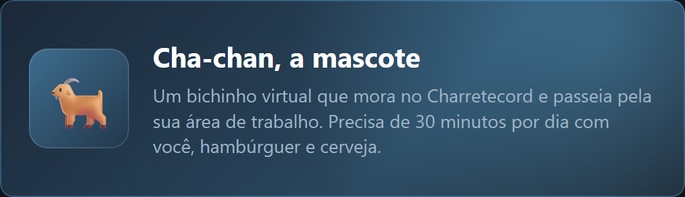
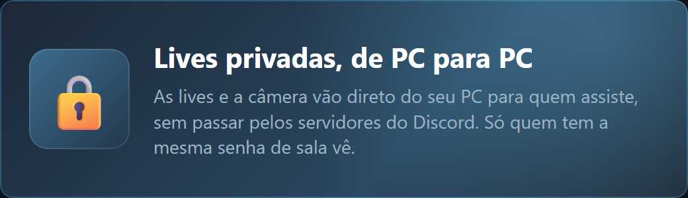
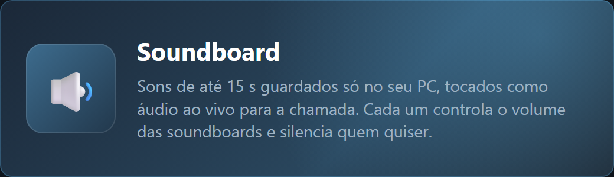
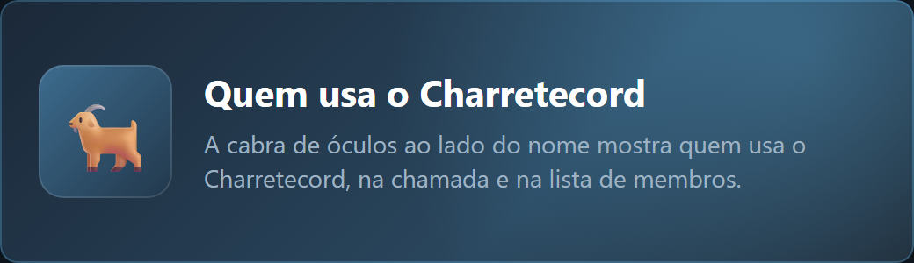

# Novidades do Charretecord

O que o Charretecord tem de diferente do Discord e o histórico de tudo o que mudou em cada versão. Dentro do app, a janela de novidades abre sozinha depois de cada atualização (e em Configurações → Plugins → CharreteLive → **Novidades do Charretecord**).

## A mais que o Discord

<table>
<tr>
<td></td>
<td></td>
</tr>
<tr>
<td></td>
<td></td>
</tr>
<tr>
<td></td>
<td></td>
</tr>
<tr>
<td></td>
<td></td>
</tr>
</table>

## No Brasil

Desde 12/08/2026, por ordem da ANPD, as transmissões ao vivo (Go Live) do Discord estão suspensas no Brasil, e o recurso do Discord foi negado em 19/11/2026. Segundo o próprio Discord, a medida também atinge chamadas de vídeo e o compartilhamento de tela. Texto e voz continuam funcionando.

Fontes: [Agência Brasil](https://agenciabrasil.ebc.com.br/radioagencia-nacional/geral/audio/2026-11/anpd-rejeita-recurso-do-discord-e-mantem-lives-suspensas-no-pais), [Olhar Digital](https://olhardigital.com.br/2026/11/19/internet-e-redes-sociais/anpd-nega-recurso-do-discord-e-mantem-lives-suspensas-no-brasil), [Carta Capital](https://www.cartacapital.com.br/toquetec/discord-suspende-recursos-de-video-no-brasil-apos-determinacao-da-anpd/).

<table>
<tr>
<td></td>
<td></td>
</tr>
</table>

## Notas de atualização

### 1.7.17 · Cha-chan assiste você morrer

26/11/2026

*Reação a eventos de tela (experimental): a Cha-chan percebe quando você morre no Bloodborne e ri da sua cara.*

#### Morreu? Ela viu.

Com a nova reação a eventos de tela ligada, a Cha-chan fica de olho no Bloodborne (bbport) e, quando aparece a tela de morte, em inglês ou português, ela aparece rindo e apontando para você, com direito a risada.

Se ela estiver guardada, aparece só para rir e vai embora em seguida. Na janela dela, um contador mostra quantas mortes ela já viu.

A função é experimental e vem desligada: ligue em Cha-chan → Reação a eventos de tela. Só a faixa do meio da janela do jogo é lida, na hora, e nada é salvo ou enviado. Desligando, o processo que olha a tela fecha na hora.

#### Novidades

- Reação a eventos de tela (experimental): a Cha-chan ri de você quando aparece a tela de morte do Bloodborne (bbport), em inglês ("YOU DIED") ou português ("VOCÊ MORREU"). Liga e desliga na janela dela; vem desligada.
- Contador de mortes no Bloodborne na janela da Cha-chan e no diário dela.

#### Melhorias

- A leitura da tela usa pouco do PC: só a faixa do meio da janela do jogo, algumas vezes por segundo, e só com o jogo em primeiro plano. Funciona em janela ou tela cheia sem bordas.

### 1.7.16 · Cha-chan inteira no colo

26/11/2026

*Correção na Cha-chan segurada pelo topete.*

#### Pega pelo topete, com jeitinho

Segurada pelo mouse, a Cha-chan agora aparece inteira, pendurada pelo topete até você soltar.

Lembrete: ela precisa de você no Charretecord pelo menos 30 minutos por dia. Dá um hambúrguer, uma cerveja ou uma brincadeira de vez em quando e deixa ela dormir quando estiver cansada.

#### Correções

- A Cha-chan aparece inteira enquanto é segurada pelo topete na área de trabalho (antes, a parte de baixo ficava cortada).

### 1.7.15 · Cha-chan ganha vida

26/11/2026

*A Cha-chan agora anda, come, bebe e senta na borda das suas janelas com animações, e o bichinho virtual ganhou energia, brincadeiras, ofensiva e diário.*

#### Mais viva do que nunca

Solta na área de trabalho, a Cha-chan agora caminha de verdade, come o hambúrguer e vira a cerveja com animação própria. Em cima de uma janela, ela senta na borda com as pernas para fora, balança os pés, espia por trás dela e às vezes deita ali mesmo para tirar um cochilo.

Para levar a Cha-chan a outro lugar, pegue ela pelo topete: ela fica pendurada enquanto você arrasta.

Na janela dela, o bichinho virtual ganhou energia e sono, brincadeiras, carinho, a ofensiva de dias seguidos, a contagem para as próximas skins e um diário com o que ela fez.

#### Novidades

- Animações da Cha-chan na área de trabalho: caminhada, comendo hambúrguer, tomando cerveja, sentada na borda das janelas com as pernas para fora, espiando por trás delas e cochilando na borda.
- Pegue a Cha-chan pelo topete para arrastar: ela fica pendurada até você soltar (ou jogar).
- Energia e sono: ela cansa ao longo do dia e recupera dormindo. Dá para pôr para dormir e acordar; se a energia acabar, ela dorme sozinha. Dormindo, ela não come nem brinca.
- Brincar (a cada 10 minutos) e carinho: deixam ela feliz. Brincar gasta energia e um pouco da barriga.
- Ofensiva: dias seguidos com os 30 minutos e o seu recorde. Também mostra quantos dias faltam para a próxima skin (7, 30, 100 e 365 dias de vida) e um diário com o que ela fez.

#### Melhorias

- O menu do botão direito na Cha-chan ganhou Brincar e Dormir/Acordar.

### 1.7.14 · Conheça a Cha-chan

25/11/2026

*O Charretecord ganhou uma mascote nova: a Cha-chan, que mora no app e pode passear pela sua área de trabalho.*

#### Cha-chan chegou

A Charrete-chan, ou só Cha-chan, é a nova cara do Charretecord: de óculos escuros, chifres e sempre na estica. Ela agora aparece ao lado do nome de quem usa o Charretecord, nas notas de atualização e na barra do topo.

Ela também é um bichinho virtual. Para continuar viva, precisa de você no Charretecord pelo menos 30 minutos por dia. Hambúrguer enche a barriga e cerveja deixa ela feliz.

Solte a Cha-chan na área de trabalho e ela passeia pela tela, sobe nas suas janelas e vai junto quando você arrasta uma delas. Dá para fazer carinho, pegar com o mouse e jogar.

Em breve: skins novas conforme o tempo de vida dela. Quanto mais tempo ela viver, mais visuais desbloqueia.

#### Novidades

- Cha-chan, a nova mascote do Charretecord: botão com o rosto dela na barra do topo abre a janela dela, com barriga, felicidade e os minutos do dia.
- Bichinho virtual: ela precisa de pelo menos 30 minutos por dia com você no Charretecord para continuar viva. Hambúrguer enche a barriga e cerveja (até 3 por dia) deixa ela feliz.
- Cha-chan na área de trabalho: solta, ela anda pela tela, sobe nas janelas abertas e acompanha a janela em que está. Clique para fazer carinho, arraste para levar a outro lugar e use o botão direito para alimentar. Ela continua na tela até por cima de jogos e vídeos em tela cheia (modo janela sem bordas).
- Em breve: skins para a Cha-chan conforme o tempo de vida dela.

#### Melhorias

- O ícone ao lado do nome de quem usa o Charretecord agora é a Cha-chan.

### 1.7.13 · Áudio da live por aplicativo

25/11/2026

*Ao transmitir uma janela, vai só o som daquele aplicativo.*

#### Novidades

- Transmitindo uma janela, a live leva só o som daquele aplicativo: músicas, chamadas e outros programas ficam de fora.

#### Melhorias

- Transmitindo a tela inteira, vai todo o som do PC, menos o do Charretecord (vozes da chamada e lives que você está assistindo).
- Na lista de voz, o indicador de quem está assistindo aparece só em quem está vendo a sua live.

### 1.7.12 · Voz mais estável

25/11/2026

*A voz da chamada fica mais estável com jogos abertos e durante as lives.*

#### Melhorias

- Durante as chamadas de voz, o Windows não coloca mais o Charretecord em modo eficiência, evitando cortes na sua voz quando há um jogo em primeiro plano.
- Limite de upload das lives: a soma do que vai para todos os espectadores fica em até 10 Mbps por padrão, dividida entre eles e reajustada quando alguém entra ou sai, preservando a qualidade da sua voz na chamada. Ajustável em Plugins → CharreteLive.
- Ao fim da chamada ou da live, os ajustes de energia do Windows voltam exatamente ao estado anterior.

### 1.7.11 · Áudio de voz e desempenho

25/11/2026

*Áudio da chamada mais estável e menor uso de memória fora das chamadas.*

#### Novidades

- Reiniciar o áudio desta pessoa: no menu de contexto de alguém da chamada, recria o áudio dela na hora, sem sair da chamada.

#### Melhorias

- Recuperação automática do áudio de cada participante: se o som de alguém parar, ele volta sozinho em poucos segundos.
- Volume de voz acima de 100% mais estável: o dispositivo de saída de áudio não é mais reconfigurado a cada atualização.
- Menor uso de memória: a detecção de jogos só funciona durante as chamadas (cerca de 80 MB a menos fora delas), e a soundboard mantém na memória apenas os últimos sons tocados.

### 1.7.10 · Atualização de segurança

23/11/2026

*Proteção reforçada para salas, senhas e atualizações, e compartilhamento de acesso sem revelar a senha. O grupo precisa estar na 1.7.7 ou mais nova para continuar se vendo nas lives, e compartilhar acesso exige a 1.7.10 nos dois computadores.*

#### Segurança

- Derivação de chave reforçada para a senha da sala: cada tentativa de adivinhação ficou cerca de 60 mil vezes mais cara.
- Identificador da sala ampliado para 256 bits e protegido contra injeção. As mensagens ficam vinculadas à sala e expiram em 5 minutos.
- Atualizações assinadas digitalmente: o aplicativo só instala versões assinadas pelo Charretecord, e somente após a sua confirmação.
- Limite de trocas da senha da sala (5 a cada 10 minutos) contra tentativas em sequência.
- Acesso compartilhado cifrado de ponta a ponta e guardado com a proteção do Windows: a senha nunca sai do computador de quem compartilha.

#### Novidades

- Compartilhar acesso à sala: clique com o botão direito em alguém do seu canal de voz para dar acesso à sua sala sem revelar a senha. Vocês passam a ver as lives um do outro, e os dois conferem um código antes de concluir.
- Campo de senha com botão Aplicar: a senha só passa a valer quando você confirma.
- Gerador de senha forte, que cria e copia uma senha aleatória para compartilhar com o grupo.
- Permissão de recompartilhar: ao compartilhar o acesso, você escolhe se a pessoa também pode compartilhar com outras. Só quem tem a senha concede essa permissão.

#### Melhorias

- Requisito mínimo de senha: 12 caracteres, combinando letras, números ou símbolos.
- Limites para as solicitações de cada participante da sala. Apenas as lives que você abrir podem ser assistidas.
- Fora da chamada, nenhuma conexão com a sala é mantida. No modo Sempre, câmeras só abrem automaticamente para quem está no seu canal de voz.
- Código da sala com 8 caracteres, para conferir com mais segurança se todos usam a mesma senha.
- Convites de acesso mais confiáveis: o convite é reenviado até o outro app responder, e um aviso aparece em 15 segundos se não houver resposta.

### 1.7.6 · Aviso de espectadores

22/11/2026

*Aviso sonoro de novos espectadores e áudio de chamada mais estável.*

#### Novidades

- Som de entrada quando alguém começa a assistir à sua live, o mesmo do Discord. Pode ser desativado em Plugins → CharreteLive.

#### Melhorias

- Áudio de voz mais estável: até 100%, cada participante é reproduzido diretamente pelo Discord, e o reforço de volume atua somente acima disso.

### 1.7.5 · Identificação na soundboard

20/11/2026

*Saiba quem está tocando cada som e ajuste o volume por pessoa.*

#### Novidades

- Indicador na lista de voz com o nome do som que cada participante está tocando.
- Volume da soundboard por pessoa, no menu de contexto do participante, além da opção de silenciar.

### 1.7.4 · Painel da soundboard

20/11/2026

*Acesso rápido aos seus sons direto do painel de voz.*

#### Melhorias

- Painel compacto acima do botão da soundboard, no padrão do Discord: um clique toca o som, e Ver todos abre o gerenciamento.

#### Correções

- Ícone do botão da soundboard centralizado.
- Notas de atualização exibidas corretamente após atualizar, aguardando o carregamento completo do Discord.

### 1.7.3 · Soundboard no painel de voz

20/11/2026

*Novo ponto de acesso à Charrete Soundboard e gerenciamento de sons redesenhado.*

#### Novidades

- Botão da Charrete Soundboard no painel de voz, ao lado da soundboard do Discord.

#### Melhorias

- Biblioteca de sons em grade, com edição de nome, ordem, reforço e exclusão.
- Acesso à soundboard centralizado no painel de voz, fora da linha Charrete Live.

### 1.7.2 · Notas de atualização revisadas

20/11/2026

*Apresentação mais clara dos recursos exclusivos e do cenário no Brasil.*

#### Melhorias

- Janela de novidades focada nos recursos exclusivos do Charretecord, com seção dedicada ao Brasil.

#### Correções

- Limite de volume de voz informado corretamente: até 1000%.

### 1.7.1 · Charrete Soundboard

20/11/2026

*Soundboard própria, sem Nitro, e base atualizada para o Vesktop 1.7.0.*

#### Novidades

- Charrete Soundboard: sons de até 15 segundos, armazenados no seu computador e transmitidos ao vivo para a chamada.
- Controle de áudio da soundboard: volume próprio, silenciamento por pessoa e opção para desativar os sons recebidos.
- Atalhos de teclado para até 12 sons.
- Janela de novidades com o histórico de versões.

#### Melhorias

- Base atualizada para o Vesktop 1.7.0.
- Orientação sobre atalhos em jogos executados como administrador.

### 1.6.31 · Amplificação de áudio da live

19/11/2026

*Mais volume para lives com áudio baixo.*

#### Novidades

- Amplificação por live (2x, 3x e 4x) com limitador, sem alterar o volume padrão.

### 1.6.30 · Nova identidade visual

18/11/2026

*Ícone de usuário do Charretecord atualizado.*

#### Melhorias

- Novo ícone de usuários do Charretecord, exibido ao lado do nome e das tags.

### 1.6.29 · Identificação de usuários

18/11/2026

*Veja quem também usa o Charretecord.*

#### Novidades

- Ícone de usuário do Charretecord na lista de voz e de membros, independente da senha de sala. Nenhum endereço IP é compartilhado.

### 1.6.28 · Codificação por hardware

18/11/2026

*Mais desempenho na transmissão.*

#### Melhorias

- Perfis H.264 High e Main, priorizando o codificador da placa de vídeo.
- Prioridade de processamento elevada para a captura durante a live.

### 1.6.27 · Desempenho em jogos

18/11/2026

*Lives mais fluidas durante jogos exigentes.*

#### Melhorias

- Prioridade de GPU em tempo real durante a live e preferência por fluidez em vez de nitidez.

#### Correções

- Taxa de quadros da captura mantida com o aplicativo em segundo plano: 30 FPS estáveis e até cerca de 49 FPS no modo 60.

### 1.6.26 · Controles da visualização expandida

18/11/2026

*Ajustes nos controles da grade da chamada.*

#### Correções

- Controles da grade reposicionados e volume da live expandida restabelecido.

### 1.6.25 · Atalhos unificados

17/11/2026

*Todos os atalhos passam pelo mesmo mecanismo.*

#### Novidades

- Aviso para jogos executados como administrador.

#### Melhorias

- Atalho Ctrl + Shift + F9 integrado ao mesmo mecanismo dos demais atalhos.

### 1.6.24 · Visualização expandida

17/11/2026

*Foco em uma live com um clique.*

#### Novidades

- Expansão de lives e câmeras com um clique, com as demais em uma faixa inferior.
- Notificação de nova versão disponível, com destaque nos botões de atualização.

### 1.6.21 · Controles da live

17/11/2026

*Mais controle sobre lives na chamada.*

#### Novidades

- Menu de contexto do Discord nos quadros da chamada.
- Botão Encerrar na linha Charrete Live e no mini player.

#### Melhorias

- Abrir uma live leva direto à chamada, com aviso sonoro para quem transmite.

### 1.6.20 · Transmissão rápida

17/11/2026

*Comece uma live em um atalho.*

#### Novidades

- Botão de atualizações na barra superior.

#### Melhorias

- Ctrl + Shift + F9 transmite instantaneamente o aplicativo em foco, com as últimas configurações.

### 1.6.19 · Atalhos globais

17/11/2026

*Atalhos que funcionam com o aplicativo em segundo plano.*

#### Novidades

- Atalhos ativos em segundo plano, incluindo ações de pressionar e segurar, com distinção entre Ctrl esquerdo e direito e teclado numérico.

### 1.6.18 · Lives na grade

17/11/2026

*A grade da chamada passa a ser o modo padrão.*

#### Melhorias

- Lives exibidas na grade da chamada por padrão, com a janela separada disponível como opção.

### 1.6.17 · Modos de visualização

17/11/2026

*Escolha como assistir às lives.*

#### Novidades

- Escolha entre a grade da chamada e uma janela separada, com controles para fechar e encerrar.

### 1.6.16 · Integração com a chamada

17/11/2026

*Lives e câmeras dentro da chamada do Discord.*

#### Novidades

- Lives e câmeras na grade da chamada, mini player e linha de status Charrete Live no painel de voz.

### 1.6.15 · Painel de voz

17/11/2026

*Botões do Discord direcionados ao Charrete Live.*

#### Correções

- Botões de câmera e de transmissão do painel de voz direcionados ao Charrete Live.

### 1.6.14 · Prévia e solicitação de live

17/11/2026

*Veja antes de entrar e peça uma live.*

#### Novidades

- Prévia ao passar o mouse sobre quem está ao vivo e solicitação de live integrada.

### 1.6.13 · Substituição do Go Live

17/11/2026

*O Charrete Live assume as transmissões e a câmera.*

#### Novidades

- Charrete Live no lugar do Go Live e da câmera do Discord, com indicador AO VIVO e câmera ponto a ponto.

### 1.6.12 · Login e atalhos de mouse

17/11/2026

*Login mais simples e novos atalhos.*

#### Novidades

- Atalhos com os botões do mouse (meio, voltar e avançar).

#### Correções

- Login sem a solicitação indevida de chave de segurança do Windows.

### 1.6.11 · Prioridade de GPU

16/11/2026

*Transmissão mais estável sob carga.*

#### Melhorias

- Prioridade de GPU elevada durante a live e respeito ao limite de FPS na captura.

### 1.6.10 · Codificação H.264

16/11/2026

*Codificação por hardware como padrão.*

#### Novidades

- Aviso sonoro quando alguém abre uma live.

#### Melhorias

- Codificação H.264 pela placa de vídeo como padrão e diagnóstico de envio.

### 1.6.8 · Atalhos do Discord

16/11/2026

*Ações do Charrete Live na tela de atalhos do Discord.*

#### Novidades

- Integração com a tela de Atalhos do teclado do Discord, incluindo ações do Charrete Live.

### 1.6.7 · Sincronização de salas

14/11/2026

*Conexão entre PCs mais tolerante.*

#### Melhorias

- Tolerância a diferenças de relógio, senha sem espaços acidentais e código de verificação da sala.

### 1.6.5 · Aviso de atualização

14/11/2026

*Confirmação sonora ao concluir uma atualização.*

#### Novidades

- Aviso sonoro ao concluir uma atualização.

### 1.6.4 · Lançamento

14/11/2026

*Primeira versão pública do Charretecord.*

#### Novidades

- Lives ponto a ponto dentro do Discord, aplicativo dedicado com instalador e versão portátil, e atualizações integradas.

---

As versões 1.6.0 a 1.6.3 foram builds de teste, e as 1.6.9, 1.6.22 e 1.6.23 tiveram mudanças desfeitas na versão seguinte. As versões 1.7.7 a 1.7.9 foram publicadas com parte das mudanças da 1.7.10, e as notas estão juntas.
