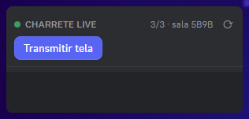
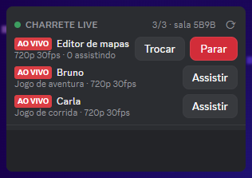
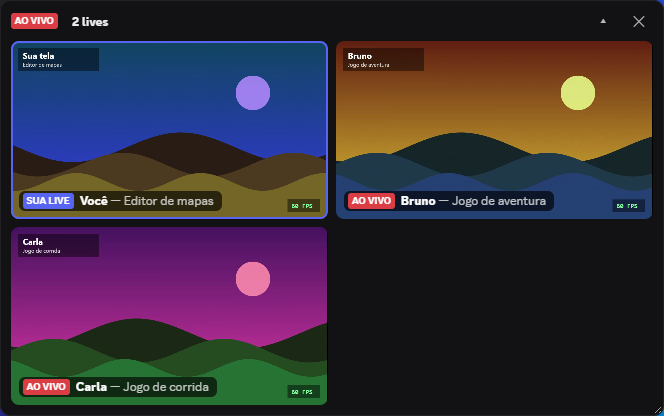
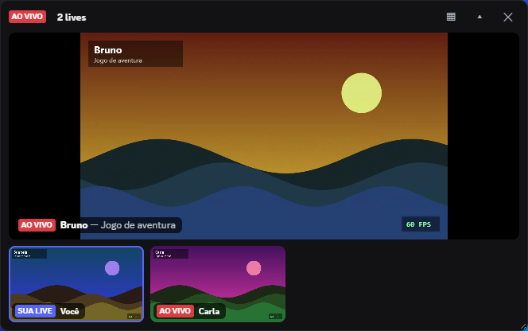

<h1 align="center">Charretecord</h1>

O Discord de sempre, com lives que vão direto do seu PC para o PC dos seus amigos.

<a href="https://github.com/Augusto-ALN/charretecord-releases/releases/latest"><b>⬇ Baixar a versão mais recente</b></a>

A voz continua sendo a do Discord. A live (tela, janela ou jogo) vai direto de PC para PC, sem passar pelos servidores dele.

- Precisa do Windows 10 22H2 ou mais novo.
- É um programa separado: não mexe no Discord instalado, e os dois podem ficar abertos ao mesmo tempo.
- Cada live aceita até 5 espectadores.

## Sumário

1. [Instalar](#1-instalar)
2. [Configurar a sala](#2-configurar-a-sala)
3. [O painel Charrete Live](#3-o-painel-charrete-live)
4. [Transmitir](#4-transmitir)
5. [Durante a live](#5-durante-a-live)
6. [Assistir](#6-assistir)
7. [Volume de voz dos amigos](#7-volume-de-voz-dos-amigos)
8. [Atualizações](#8-atualizações)
9. [Problemas comuns](#9-problemas-comuns)
10. [Todas as opções](#10-todas-as-opções)

---

## 1. Instalar

Na [página de versões](https://github.com/Augusto-ALN/charretecord-releases/releases/latest), baixe um destes arquivos:

| Arquivo | Para quem | Onde ficam seus dados |
|---|---|---|
| `Charretecord-Setup-x.y.z.exe` | Quem quer instalar como um programa normal, com atalho no menu Iniciar. | Na pasta do seu usuário do Windows. |
| `Charretecord-Portatil-x.y.z.zip` | Quem prefere não instalar nada. Extraia numa pasta e abra `charretecord.exe`. | Na pasta `Data`, ao lado do `charretecord.exe`. |

Na primeira vez, aparece uma tela de boas-vindas. Clique para continuar e entre na sua conta do Discord como sempre.

> [!WARNING]
> **Aviso de "arquivo não confiável":** o app não tem assinatura digital paga, então o Windows desconfia dele.
> - **Zip:** antes de extrair, clique nele com o botão direito → **Propriedades** → marque **Desbloquear** → **OK**.
> - **Tela azul do SmartScreen:** clique em **Mais informações** → **Executar assim mesmo**.

## 2. Configurar a sala

Todo mundo que vai transmitir e assistir junto precisa usar a mesma **senha da sala**. É ela que separa o seu grupo do resto do mundo: tudo é criptografado com ela, e quem não tem a senha não vê as lives nem quem está online.

1. Abra **Configurações do usuário** (a engrenagem no canto inferior esquerdo).
2. Na seção **Charretecord**, entre em **Plugins** e procure **CharreteLive**.
3. Cole a senha combinada com o grupo em **Senha da sala**.
4. Escolha **Onde as lives aparecem**:
   - **Mesmo canal de voz** (padrão): você só vê as lives de quem está no mesmo canal de voz que você.
   - **Sempre**: todos com a mesma senha se veem, em qualquer canal ou até fora de chamada.

> [!TIP]
> Copie e cole a senha em vez de digitar. Para conferir se todo mundo está com a mesma senha, compare o **código da sala** que aparece no painel (por exemplo, `sala 5B9B`): ele é igual em todos os PCs que usam a mesma senha.

## 3. O painel Charrete Live

Quando você entra num canal de voz (ou a qualquer momento, no modo "Sempre"), aparece o painel **Charrete Live** logo acima da sua foto, no canto inferior esquerdo.

- **Bolinha verde**: pronto para transmitir e assistir. **Vermelha**: sem conexão de sinalização (veja [Problemas comuns](#9-problemas-comuns)).
- **`3/3`**: quantos servidores de encontro estão conectados.
- **`sala XXXX`**: o código da sua senha.
- **⟳**: abre a janela de atualizações.
- Passe o mouse em cima de "Charrete Live" para ver o estado de cada servidor.

## 4. Transmitir

Clique em **Transmitir tela** no painel para abrir o seletor de fonte:

- **Jogos**: jogos que o Discord reconhece e qualquer programa aberto em tela cheia.
- **Telas**: um monitor inteiro.
- **Aplicativos**: uma janela só, como o navegador, um editor ou um jogo em janela.
- **Resolução e FPS**: o padrão é 1080p a 60 fps. Se a internet de quem transmite for fraca, use 720p ou 30 fps.
- **Áudio**: "Som do PC (sem o Discord)" manda todo o som do computador, menos o do próprio Charretecord. As vozes da chamada e as lives que você está assistindo ficam de fora, então ninguém ouve eco.

### Atalho e jogos detectados

- O atalho **Ctrl + Shift + F9** inicia ou para a live de qualquer lugar, até de dentro do jogo. Se houver um jogo aberto em tela cheia, ele transmite esse jogo direto. Se não houver, abre o seletor.
- Quando você abre um jogo durante a chamada, o painel mostra o nome dele com um botão **Transmitir**, e aparece a notificação "Transmitir jogo?".

> [!TIP]
> Nos jogos, prefira o modo **tela cheia sem bordas** (borderless). Na tela cheia exclusiva, dar Alt+Tab pode deixar a live preta.

## 5. Durante a live

A sua live aparece no topo do painel, com a resolução, o FPS e quantas pessoas estão assistindo.

- **Prévia**: mostra a sua própria live no palco, para conferir o que os outros estão vendo. O botão aparece quando a prévia está escondida.
- **Trocar**: troca a fonte (outra tela, janela ou jogo) **sem derrubar** quem está assistindo. Na troca, também dá para ligar ou desligar o áudio.
- **Parar**: encerra a live. O atalho Ctrl + Shift + F9 também encerra.

## 6. Assistir

As lives dos amigos aparecem no painel com o selo **AO VIVO**. Clique em **Assistir** e a live abre no **palco**, em cima do chat. Dá para assistir várias ao mesmo tempo.

*Em grade, todas as lives ficam do mesmo tamanho. A sua prévia aparece com o selo "SUA LIVE".*

*Clique numa live para deixá-la em destaque, e as outras viram miniaturas. Para voltar à grade, clique de novo na live ou use o botão ▦.*

### Controles de cada live

Passe o mouse em cima de uma live para ver os controles e as estatísticas da conexão (tipo de conexão, resolução, FPS, velocidade e atraso):

| Botão | O que faz |
|---|---|
| Volume e 🔊 | Ajusta ou silencia o som da live. Só aparecem quando a live tem som. |
| ⤢ | Coloca a live em destaque (o mesmo que clicar nela). |
| ⧉ | **Miniplayer**: uma janelinha flutuante que fica por cima de tudo, até de jogos sem bordas. |
| ⛶ | Entra na tela cheia. O mesmo botão sai dela, e duplo clique ou Esc também saem. |
| ✕ | Para de assistir essa live. |
| 🔄 | Só na sua prévia: troca o que você está transmitindo. |

- No topo do palco, **▴** recolhe o palco sem parar as lives, e **✕** fecha todas.
- Arraste a borda de baixo do palco para deixá-lo maior ou menor.

## 7. Volume de voz dos amigos

O Charretecord vem com o volume de voz liberado até **500%**. Durante a chamada, clique com o botão direito no amigo → **Volume do usuário** e arraste além dos 100%.

Para mudar esse limite, vá em Configurações → Charretecord → Plugins → **VolumeBooster**.

## 8. Atualizações

Clique no **⟳** do painel, ou vá em Configurações → Plugins → CharreteLive → **Procurar atualizações**.

- Quando há versão nova, o botão vira **Atualizar para x.y.z**. Ao clicar, o app baixa a versão nova, fecha, troca os arquivos e abre de novo. Na versão portátil, a pasta `Data` (com o seu login) é mantida.
- Quando a atualização termina, toca um **berro de bode** e aparece o aviso "Charretecord atualizado".
- O app também confere sozinho a cada 3 horas e pergunta se você quer atualizar.
- **Vesktop** e **Vencord** são a base do app. As novidades deles chegam na próxima versão do Charretecord.

## 9. Problemas comuns

| O que acontece | Causa provável | O que fazer |
|---|---|---|
| Bolinha vermelha, "0/3" | A rede bloqueia a conexão que os PCs usam para se encontrar. É comum em redes de empresa ou faculdade e com antivírus rígido. | Teste em outra rede (por exemplo, com a internet do celular). Se funcionar, o problema é a rede. |
| Não vejo a live de ninguém | Senha da sala diferente, ou vocês estão em canais de voz diferentes. | Compare o código `sala XXXX` no painel. Se for diferente, cole a senha de novo. Entrem no mesmo canal, ou usem o modo "Sempre". |
| Aviso "O relógio deste PC está X min adiantado/atrasado" | A data ou a hora do Windows está errada. | Nas configurações do Windows, vá em Hora e idioma e ligue **Definir horário automaticamente**. |
| A live aparece, mas fica em "conectando" | A rede de um dos dois não permite conexão direta. Acontece com alguns tipos de CGNAT, 4G/5G ou firewall. | É preciso configurar um servidor TURN nas opções do plugin. Peça para quem cuida do Charretecord. |
| Live preta | Jogo em tela cheia exclusiva que foi minimizado. | Use o modo "tela cheia sem bordas" no jogo. |
| Imagem travando ou borrada | O upload de quem transmite está no limite, porque cada espectador recebe uma cópia da live. | Baixe para 720p ou 30 fps no seletor. |
| Ninguém ouve o som do jogo | A live foi iniciada com "Sem áudio". | Clique em **Trocar** e escolha "Som do PC (sem o Discord)". |

## 10. Todas as opções

Ficam em Configurações → Charretecord → Plugins → **CharreteLive**:

| Opção | O que faz | Padrão |
|---|---|---|
| Senha da sala | Precisa ser igual em todos os PCs do grupo. Só quem tem a senha vê e assiste às lives. | vazia |
| Onde as lives aparecem | Só para quem está no mesmo canal de voz, ou sempre. | Mesmo canal |
| Atalho | Tecla global para iniciar e parar a live. Deixe vazio para desligar. | Ctrl+Shift+F9 |
| Ação do atalho | Inteligente (transmite o jogo detectado ou abre o seletor), sempre abrir o seletor, ou repetir a última fonte. | Inteligente |
| Resolução e FPS | A qualidade que já vem marcada no seletor. | 1080p, 60 fps |
| Bitrate máximo | Limite de velocidade do vídeo, em kbps. Com 0, o app decide pela resolução. | 0 (automático) |
| Codec | Formato do vídeo. O H.264 usa a placa de vídeo na maioria dos PCs. | Automático |
| Áudio por padrão | Se o seletor já abre com o som do PC marcado. | Ligado |
| Máximo de espectadores | Quantas pessoas podem assistir à sua live. Cada uma usa parte do seu upload. | 5 |
| Detectar jogos | Reconhece jogos e programas abertos em tela cheia. | Ligado |
| Notificar jogo | Mostra "Transmitir jogo?" quando um jogo abre durante a chamada. | Ligado |
| Brokers, STUN e TURN | Servidores de encontro e de conexão. Só mexa se alguém do grupo pedir. | já configurados |

---

As imagens deste guia foram feitas com contas e vídeos de exemplo. Client mods violam os Termos de Serviço do Discord: use por sua conta e risco.
