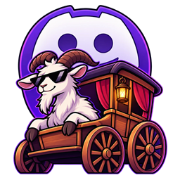
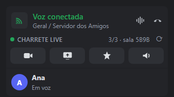
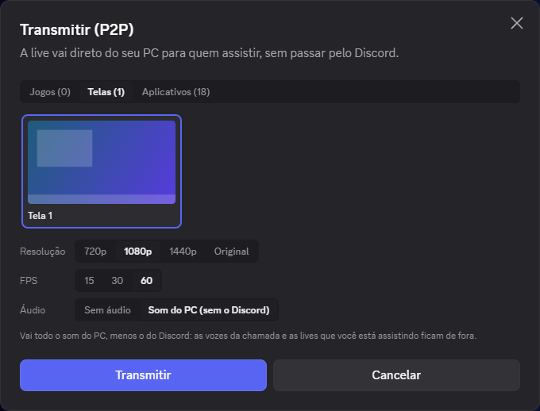
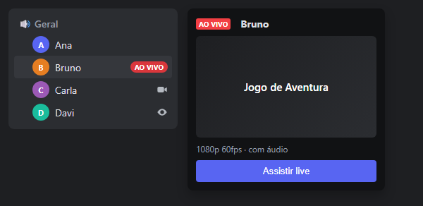
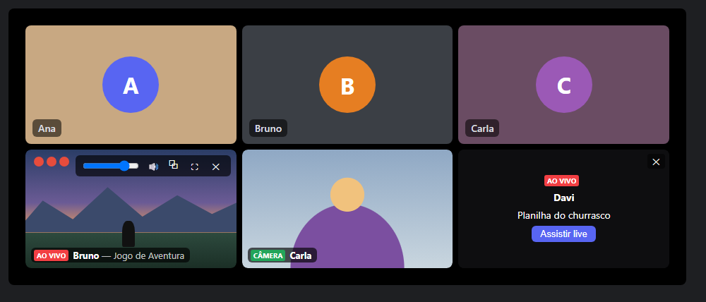
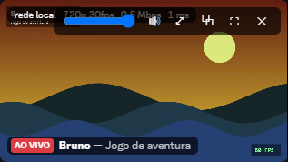
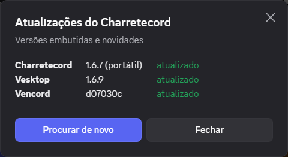

<h1 align="center">Charretecord</h1>

O Discord de sempre, com lives e câmeras que vão direto do seu PC para o PC dos seus amigos.

<a href="https://github.com/Augusto-ALN/charretecord-releases/releases/latest"><b>⬇ Baixar a versão mais recente</b></a>

A voz continua sendo a do Discord. A live (tela, janela ou jogo) e a câmera vão direto de PC para PC, sem passar pelos servidores dele. Os botões de transmitir e de câmera do próprio Discord já usam o Charrete Live, então você usa tudo do jeito de sempre.

- Precisa do Windows 10 22H2 ou mais novo.
- É um programa separado: não mexe no Discord instalado, e os dois podem ficar abertos ao mesmo tempo.
- Cada live aceita até 5 espectadores (dá para mudar nas opções).
- Só quem usa o Charretecord, com a mesma senha da sala, vê as suas lives e a sua câmera.

## Sumário

1. [Instalar](#1-instalar)
2. [Configurar a sala](#2-configurar-a-sala)
3. [A linha Charrete Live](#3-a-linha-charrete-live)
4. [Transmitir](#4-transmitir)
5. [Durante a live](#5-durante-a-live)
6. [Assistir](#6-assistir)
7. [Câmera](#7-câmera)
8. [Pedir live](#8-pedir-live)
9. [Atalhos do teclado e do mouse](#9-atalhos-do-teclado-e-do-mouse)
10. [Volume de voz dos amigos](#10-volume-de-voz-dos-amigos)
11. [Atualizações](#11-atualizações)
12. [Problemas comuns](#12-problemas-comuns)
13. [Todas as opções](#13-todas-as-opções)

---

## 1. Instalar

Na [página de versões](https://github.com/Augusto-ALN/charretecord-releases/releases/latest), baixe um destes arquivos:

| Arquivo | Para quem | Onde ficam seus dados |
|---|---|---|
| `Charretecord-Setup-x.y.z.exe` | Quem quer instalar como um programa normal, com atalho no menu Iniciar. | Na pasta do seu usuário do Windows. |
| `Charretecord-Portatil-x.y.z.zip` | Quem prefere não instalar nada. Extraia numa pasta e abra `charretecord.exe`. | Na pasta `Data`, ao lado do `charretecord.exe`. |

Na primeira vez, aparece uma tela de boas-vindas. Clique para continuar e entre na sua conta do Discord como sempre.

> [!WARNING]
> **Aviso de "arquivo não confiável":** o app não tem assinatura digital paga, então o Windows desconfia dele.
> - **Zip:** antes de extrair, clique nele com o botão direito → **Propriedades** → marque **Desbloquear** → **OK**.
> - **Tela azul do SmartScreen:** clique em **Mais informações** → **Executar assim mesmo**.

## 2. Configurar a sala

Todo mundo que vai transmitir e assistir junto precisa usar a mesma **senha da sala**. É ela que separa o seu grupo do resto do mundo: tudo é criptografado com ela, e quem não tem a senha não vê as lives nem quem está online.

1. Abra **Configurações do usuário** (a engrenagem no canto inferior esquerdo).
2. Na seção **Charretecord**, entre em **Plugins** e procure **CharreteLive**.
3. Cole a senha combinada com o grupo em **Senha da sala**.
4. Escolha **Onde as lives aparecem**:
   - **Mesmo canal de voz** (padrão): você só vê as lives de quem está no mesmo canal de voz que você.
   - **Sempre**: todos com a mesma senha se veem, em qualquer canal ou até fora de chamada.

> [!TIP]
> Copie e cole a senha em vez de digitar. Para conferir se todo mundo está com a mesma senha, compare o **código da sala** que aparece na linha Charrete Live (por exemplo, `sala 5B9B`): ele é igual em todos os PCs que usam a mesma senha.

## 3. A linha Charrete Live

Quando você entra num canal de voz, aparece a linha **Charrete Live** no painel "Voz conectada", logo acima dos botões de câmera e de transmitir:

- **Bolinha verde**: pronto para transmitir e assistir. **Vermelha**: sem conexão com os servidores de encontro (veja [Problemas comuns](#12-problemas-comuns)).
- **`3/3`**: quantos servidores de encontro estão conectados.
- **`sala XXXX`**: o código da sua senha.
- **⟳**: abre a janela de atualizações.
- Passe o mouse em cima de "Charrete Live" para ver o estado de cada servidor e, durante a sua live, a qualidade com que ela está saindo.
- Avisos (relógio do PC errado, processador ou internet limitando a live) aparecem logo abaixo da linha, só quando há algum problema.

## 4. Transmitir

Use o botão de **compartilhar tela** do próprio Discord: o do painel "Voz conectada" ou o da barra da chamada. Ele abre o seletor do Charrete Live:

- **Jogos**: jogos que o Discord reconhece e qualquer programa aberto em tela cheia.
- **Telas**: um monitor inteiro.
- **Aplicativos**: uma janela só, como o navegador, um editor ou um jogo em janela.
- **Resolução e FPS**: o padrão é 1080p a 60 fps. Mesmo com o jogo rodando a 120 fps ou mais, a live nunca passa do FPS escolhido. Se a internet de quem transmite for fraca, use 720p ou 30 fps.
- **Áudio**: "Som do PC (sem o Discord)" manda todo o som do computador, menos o do próprio Charretecord. As vozes da chamada e as lives que você está assistindo ficam de fora, então ninguém ouve eco.

Qualquer outro caminho do Discord que iniciaria uma transmissão (o botão de transmitir um jogo detectado, o menu de transmissões, um pedido de transmissão) também abre o Charrete Live. Quando alguém abre uma live, a sala ouve um berro de bode bem baixinho.

### Jogos detectados

- Quando você abre um jogo durante a chamada, aparece a notificação "Transmitir jogo?".
- O atalho **Ctrl + Shift + F9** inicia ou para a live de qualquer lugar, até de dentro do jogo. Ele não pergunta nada: transmite o **aplicativo em foco** (a janela em que você está), com a resolução, o FPS e o áudio que você escolheu da última vez no seletor. Se o foco estiver no próprio Charretecord, ele transmite a tela onde está o mouse. Veja também [Atalhos](#9-atalhos-do-teclado-e-do-mouse).

> [!TIP]
> Nos jogos, prefira o modo **tela cheia sem bordas** (borderless). Na tela cheia exclusiva, dar Alt+Tab pode deixar a live preta.

## 5. Durante a live

- Quando a live abre, toca o berro de bode, o mesmo que os outros da chamada ouvem.
- A linha **Charrete Live** (acima dos botões de voz) mostra **AO VIVO**, o que você está transmitindo, quantos estão assistindo e o botão vermelho **Encerrar**. O mini player também tem **⏹ Encerrar sua live**.
- O botão de compartilhar tela fica **aceso**. Clicar nele **encerra** a live. A setinha ao lado dele **troca a fonte** (outra tela, janela ou jogo) **sem derrubar** quem está assistindo, e na troca dá para ligar ou desligar o áudio.
- A sua live aparece com o selo **SUA LIVE**, para você conferir o que os outros estão vendo. No quadro dela:
  - **⏹** encerra a live;
  - **🔄** troca a fonte;
  - **✕** só esconde a prévia (a live continua). Para ver de novo, clique no **AO VIVO** ao lado do seu nome na lista de voz.
- O atalho Ctrl + Shift + F9 também encerra.

## 6. Assistir

Quem está transmitindo aparece com o selo **AO VIVO** ao lado do nome, na lista do canal de voz. Quem está assistindo alguma live aparece com um **olhinho**.

### Prévia ao passar o mouse

Passe o mouse em cima de quem está ao vivo para ver o que está sendo transmitido. Clique no quadro ou em **Assistir live** para abrir.

Também dá para clicar direto no selo **AO VIVO**, ou dar duplo clique no nome.

### Na chamada (padrão)

As lives e câmeras aparecem como quadros na **grade de vídeo da chamada**, ao lado das pessoas, como o Go Live do Discord:

- Ao abrir uma live (pela lista de voz, pela prévia ou pelo selo **AO VIVO**), o Charretecord vai direto para a tela da chamada.
- Lives que você ainda não abriu aparecem com o botão **Assistir live**. O **✕** no canto esconde esse quadro.
- **Duplo clique** num quadro coloca a live em tela cheia.
- **Botão direito** num quadro abre o menu da pessoa que está transmitindo, igual ao de clicar nela na chamada (volume, silenciar, perfil...).
- Funciona com "Mostrar participantes sem vídeo" desligado: se tiver live ou câmera do Charrete Live, a grade continua aparecendo.
- Saindo da chamada (por exemplo, abrindo um canal de texto), o que você está assistindo continua num **mini player** no canto da tela. Clique nele para voltar para a chamada.

### Janela separada (legacy)

Se preferir o jeito antigo, mude **Onde mostrar as lives e câmeras** para **Janela separada** nas opções. As lives abrem num **palco** em cima do chat, com grade própria:

*Em grade, todas as lives ficam do mesmo tamanho.*

*Clique numa live para deixá-la em destaque, e as outras viram miniaturas. Para voltar à grade, clique de novo na live ou use o botão ▦. No topo do palco, **▴** recolhe sem parar as lives e **✕** fecha todas. Arraste a borda de baixo para mudar a altura.*

### Controles de cada live

Passe o mouse em cima de uma live para ver os controles e as estatísticas da conexão (tipo de conexão, resolução, FPS, velocidade e atraso):

| Botão | O que faz |
|---|---|
| Volume e 🔊 | Ajusta ou silencia o som da live. Só aparecem quando a live tem som. |
| ⤢ | Só na janela separada: coloca a live em destaque (o mesmo que clicar nela). |
| ⧉ | **Miniplayer**: uma janelinha flutuante que fica por cima de tudo, até de jogos sem bordas. Dá para abrir um para cada live ou câmera ao mesmo tempo. O ⧉ fica aceso enquanto o miniplayer daquela live está aberto, e clicar nele de novo fecha só aquele. Passe o mouse na janelinha para ver o volume. |
| ⛶ | Entra na tela cheia. O mesmo botão sai dela, e duplo clique ou Esc também saem. |
| ✕ | Para de assistir essa live. Ela some da tela até você abrir de novo pelo AO VIVO. |
| ⏹ e 🔄 | Só na sua live: encerra, ou troca o que você está transmitindo. |

## 7. Câmera

O botão de **câmera** do Discord (no painel "Voz conectada" ou na barra da chamada) liga a câmera pelo Charrete Live, direto de PC para PC, em 720p.

- A câmera de quem ligar aparece **sozinha** para todos na chamada, com o selo verde **CÂMERA**. Para não abrir sozinha, desligue **Mostrar câmeras automaticamente** nas opções: aí ela aparece com o botão **Ver câmera**.
- A sua aparece espelhada, com o selo **SUA CÂMERA**. O **✕** nela desliga a câmera.
- Dá para transmitir a tela e ficar com a câmera ligada ao mesmo tempo.
- Quem usa o Discord normal (sem Charretecord) não vê a sua câmera.

## 8. Pedir live

Passe o mouse em alguém da chamada que não está transmitindo e use o botão de **pedir transmissão** do cartão. O pedido vai pelo Charrete Live: a pessoa recebe a notificação "Fulano pediu para você abrir uma live", e clicar nela abre o seletor de transmissão.

Para quem não usa o Charretecord, o botão continua mandando o pedido normal do Discord.

## 9. Atalhos do teclado e do mouse

Em Configurações → **Atalhos do teclado** (a tela do próprio Discord), dá para criar atalhos para qualquer ação, inclusive estas do Charrete Live:

- **Charrete Live: iniciar ou parar a live**
- **Charrete Live: escolher o que transmitir**
- **Charrete Live: parar a live**

Os atalhos funcionam **em qualquer janela**, até com um jogo em tela cheia aberto ou em outro monitor. Isso vale também para as ações de segurar, como falar ao pressionar.

- **Tecla exata:** o atalho guarda a tecla que você apertou. **Ctrl esquerdo** e **Ctrl direito** (e também Shift e Alt) são atalhos diferentes, e os **números do numpad** são diferentes dos números de cima do teclado. Atalhos gravados antes da 1.6.19 aceitam os dois lados; grave de novo para separar.
- **Botões do mouse:** na hora de gravar o atalho, aperte o botão do **meio**, **voltar** ou **avançar** do mouse, sozinho ou com Ctrl, Shift ou Alt.
- O atalho próprio do plugin (**Ctrl + Shift + F9**) continua valendo e pode ser mudado ou desligado nas opções.

## 10. Volume de voz dos amigos

O Charretecord vem com o volume de voz liberado até **500%**. Durante a chamada, clique com o botão direito no amigo → **Volume do usuário** e arraste além dos 100%.

Para mudar esse limite, vá em Configurações → Charretecord → Plugins → **VolumeBooster**.

## 11. Atualizações

Clique no **⟳** da barra do topo (no canto direito, depois do botão de ajuda) ou no ⟳ da linha Charrete Live. Também dá para ir em Configurações → Plugins → CharreteLive → **Procurar atualizações**. Quando há versão nova, o ⟳ da barra do topo fica verde, com uma bolinha.

- Quando há versão nova, o botão vira **Atualizar para x.y.z**. Ao clicar, o app baixa a versão nova, fecha, troca os arquivos e abre de novo. Na versão portátil, a pasta `Data` (com o seu login) é mantida.
- Quando a atualização termina, toca um **berro de bode** e aparece o aviso "Charretecord atualizado".
- O app também confere sozinho a cada 3 horas e pergunta se você quer atualizar.
- **Vesktop** e **Vencord** são a base do app. As novidades deles chegam na próxima versão do Charretecord.

> [!IMPORTANT]
> As primeiras versões não tinham o botão ⟳. Se o seu painel do Charrete Live mostra "sinalização" no lugar de "sala XXXX", baixe e instale a versão mais recente pela [página de versões](https://github.com/Augusto-ALN/charretecord-releases/releases/latest). Depois disso, as atualizações chegam sozinhas.

## 12. Problemas comuns

| O que acontece | Causa provável | O que fazer |
|---|---|---|
| Bolinha vermelha, "0/3" | A rede bloqueia a conexão que os PCs usam para se encontrar. É comum em redes de empresa ou faculdade e com antivírus rígido. | Teste em outra rede (por exemplo, com a internet do celular). Se funcionar, o problema é a rede. |
| Não vejo a live de ninguém | Senha da sala diferente, ou vocês estão em canais de voz diferentes. | Compare o código `sala XXXX` na linha Charrete Live. Se for diferente, cole a senha de novo. Entrem no mesmo canal, ou usem o modo "Sempre". |
| Aviso "O relógio deste PC está X min adiantado/atrasado" | A data ou a hora do Windows está errada. | Nas configurações do Windows, vá em Hora e idioma e ligue **Definir horário automaticamente**. |
| A live de um amigo fica sempre em "conectando" e ele não tem o botão ⟳ | Ele está numa versão antiga, que não conversa com as novas. | Ele precisa baixar e instalar a versão mais recente uma vez. Veja [Atualizações](#11-atualizações). |
| A live aparece, mas fica em "conectando" | A rede de um dos dois não permite conexão direta. Acontece com alguns tipos de CGNAT, 4G/5G ou firewall. Deixar o IPv6 ligado no Windows costuma resolver. | Se não resolver, é preciso configurar um servidor TURN nas opções do plugin. Peça para quem cuida do Charretecord. |
| Live preta ou parada no jogo | Jogo em tela cheia exclusiva. | Use o modo "tela cheia sem bordas" no jogo. |
| Imagem travando em cenas pesadas do jogo | O jogo está usando a placa de vídeo inteira. | Limite o FPS do jogo (por exemplo, 60). A live já usa a placa de vídeo com prioridade alta, mas sobra pouco quando o jogo roda sem limite. |
| Imagem borrada | O upload de quem transmite está no limite, porque cada espectador recebe uma cópia da live. | Baixe para 720p ou 30 fps no seletor. Passe o mouse na linha Charrete Live para ver o que está limitando. |
| Ninguém ouve o som do jogo | A live foi iniciada com "Sem áudio". | Use a setinha do botão de transmitir para trocar a fonte e escolha "Som do PC (sem o Discord)". |
| Atalho não funciona dentro do jogo | Versão anterior à 1.6.19, ou o jogo roda como administrador. | Atualize pelo ⟳. Se o jogo roda como administrador, o Windows só deixa os atalhos chegarem se o Charretecord também rodar como administrador. |

## 13. Todas as opções

Ficam em Configurações → Charretecord → Plugins → **CharreteLive**:

| Opção | O que faz | Padrão |
|---|---|---|
| Senha da sala | Precisa ser igual em todos os PCs do grupo. Só quem tem a senha vê e assiste às lives. | vazia |
| Onde as lives aparecem | Só para quem está no mesmo canal de voz, ou sempre. | Mesmo canal |
| Onde mostrar as lives e câmeras | Na grade de vídeo da chamada, ou numa janela separada acima do chat (legacy). | Na chamada |
| Mostrar câmeras automaticamente | A câmera de quem ligar aparece sozinha. Desligado, aparece com o botão "Ver câmera". | Ligado |
| Atalho | Tecla global para iniciar e parar a live. Deixe vazio para desligar. | Ctrl+Shift+F9 |
| Ação do atalho | Transmitir o aplicativo em foco sem perguntar, sempre abrir o seletor, ou repetir a última fonte. | Aplicativo em foco |
| Resolução e FPS | A qualidade que já vem marcada no seletor. | 1080p, 60 fps |
| Bitrate máximo | Limite de velocidade do vídeo, em kbps. Com 0, o app decide pela resolução. | 0 (automático) |
| Codec | Formato do vídeo. O automático usa H.264 pela placa de vídeo. | Automático |
| Áudio por padrão | Se o seletor já abre com o som do PC marcado. | Ligado |
| Máximo de espectadores | Quantas pessoas podem assistir à sua live (e à sua câmera). Cada uma usa parte do seu upload. | 5 |
| Detectar jogos | Reconhece jogos e programas abertos em tela cheia. | Ligado |
| Notificar jogo | Mostra "Transmitir jogo?" quando um jogo abre durante a chamada. | Ligado |
| Brokers, STUN e TURN | Servidores de encontro e de conexão. Só mexa se alguém do grupo pedir. | já configurados |

---

As imagens deste guia foram feitas com contas e vídeos de exemplo. Client mods violam os Termos de Serviço do Discord: use por sua conta e risco.
